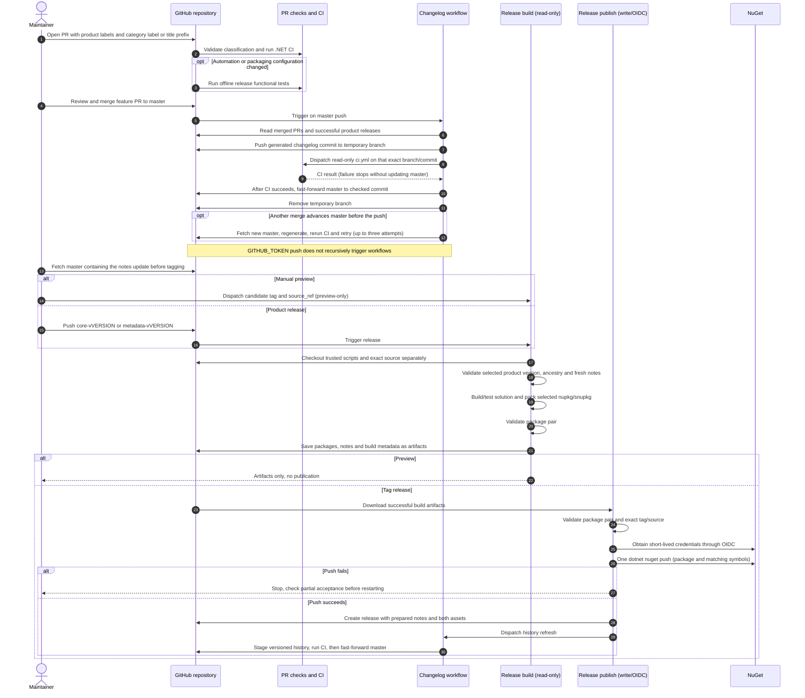

# Release sequence

Updated: 13 November 2026. This describes the simplified implementation.

Pending notes and published history are automatic bot commits on master. No changelog PR, PR-creation permission, or follow-up approval is needed. The required **ci** check runs before each direct write; other repository rules must also permit direct writes.

## Simplifications applied

- PowerShell handles policy and text/JSON transformations; `gh` and `dotnet` perform operations directly. No Node runtime or custom GitHub HTTP client.
- One read-only `pull_request` classification workflow fetches PR metadata once and reports a single native **PR release labels** check. Manual validation dispatch verifies the selected PR head commit.
- Product/category definitions live in one JSON configuration file.
- One serialized changelog writer stages only the two note files on temporary branches, dispatches CI on each exact commit, then fast-forwards master, with bounded regeneration retries for concurrent merges and no force pushes.
- Label provisioning and GitHub publication are short workflow steps, not separate wrapper scripts.
- Tag pushes are the only publication trigger. Manual dispatch only builds previews.
- One package push also uploads matching symbols. Partial success is recovered manually from artifacts.
- No release ledger, merge queues, emergency audit mechanism, checksums or draft-retry framework.
- Tests assert observable behavior using local Git and mocked GitHub responses, not exact command argument order or exception wording. They run only for relevant file changes or manual dispatch.

## Security boundaries retained

- Keep the build/publish separation: source builds have read-only credentials; only the trusted publish job has write/OIDC credentials.
- Keep source PR review, label validation and normal CI. The bot's derived Markdown-only commits explicitly run read-only CI before the protected push, without recursive push-triggered runs; release builds still test the exact tagged source.
- Keep the fresh-notes gate before publication. Maintainers tag a source containing the automatic notes commit, not an earlier feature merge with stale notes.

See [maintainer instructions](../RELEASE.md) and [the release-flow specification](release-flow.md).
