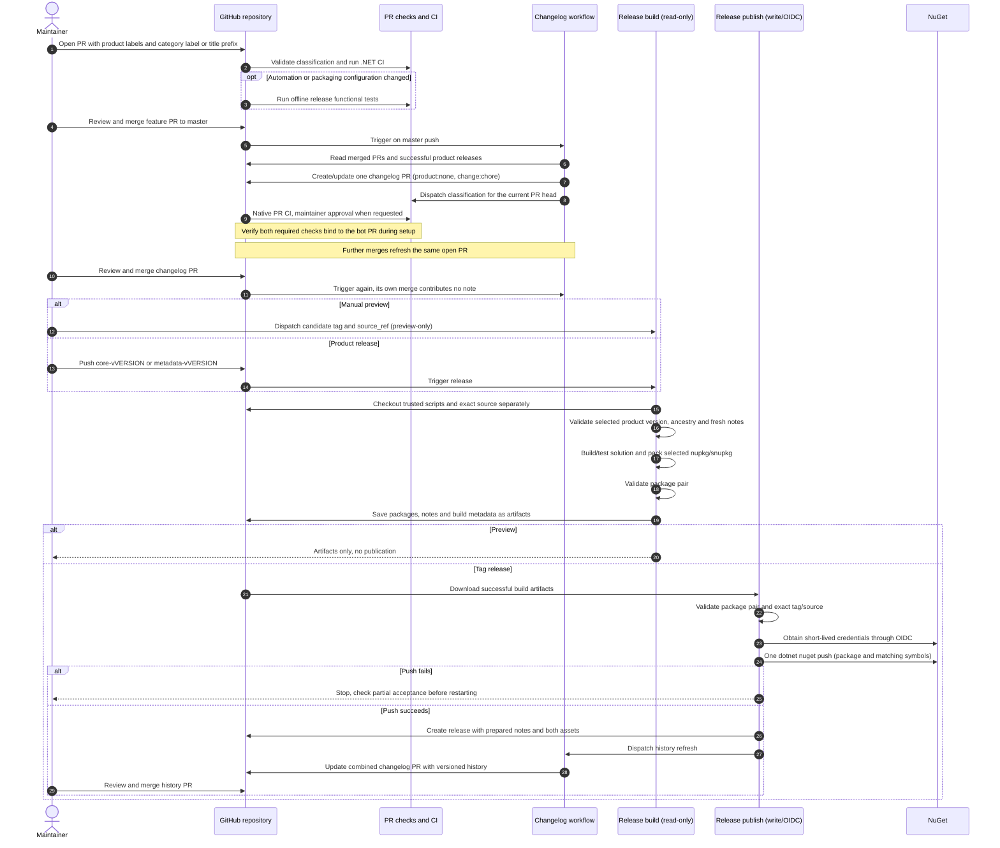

# Release sequence

Updated: 13 November 2026. This describes the simplified implementation.

Pending notes and published history normally require two changelog PR merges, but later feature merges can share the history PR. There is only one open changelog PR at a time.

## Simplifications applied

- PowerShell handles policy and text/JSON transformations; `gh` and `dotnet` perform operations directly. No Node runtime or custom GitHub HTTP client.
- One read-only `pull_request` classification workflow fetches PR metadata once and reports a single native **PR release labels** check. Explicit bot-PR dispatch runs on its head branch.
- Product/category definitions live in one JSON configuration file.
- Label provisioning and GitHub publication are short workflow steps, not separate wrapper scripts.
- Tag pushes are the only publication trigger. Manual dispatch only builds previews.
- One package push also uploads matching symbols. Partial success is recovered manually from artifacts.
- No release ledger, merge queues, emergency audit mechanism, checksums or draft-retry framework.
- Tests assert observable behavior using local Git and mocked GitHub responses, not exact command argument order or exception wording. They run only for relevant file changes or manual dispatch.

## Further simplifications worth considering

1. **Keep the current review gate unless it becomes a burden.** Generating notes only at release time would remove the pre-release changelog PR, but files would no longer stay current after merges. That changes the agreed functionality.
2. **Keep the build/publish separation.** Combining them shortens YAML but exposes write/OIDC credentials to source builds; the current security boundary is worth the extra job.
3. **Start with ordinary CI on bot PRs.** A special Markdown-only CI shortcut could save builds, but adds another policy and reporting path. Add it only if actual CI cost warrants it.

See [maintainer instructions](../RELEASE.md) and [the release-flow specification](release-flow.md).
